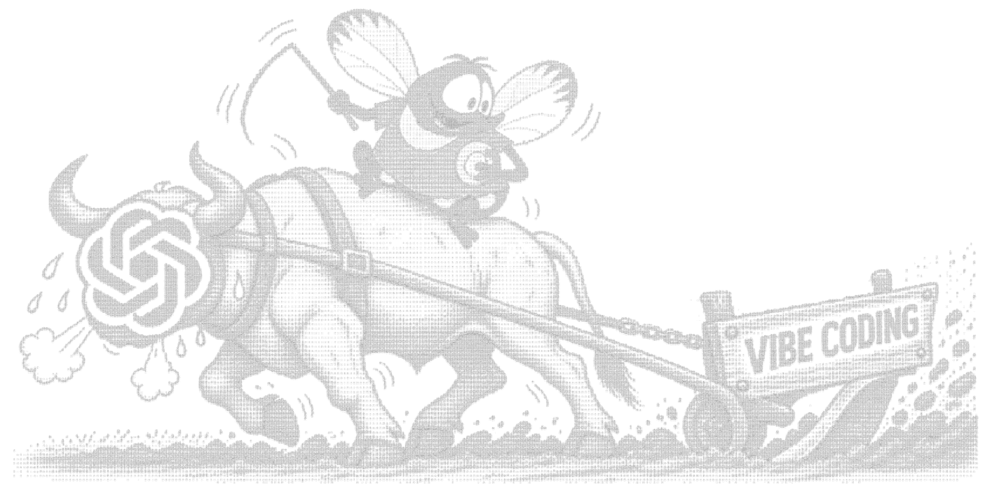

# Vibe Coding: AI-боты для бизнеса

**Университет ИТМО · группа U4225 · 2026/2027**

[](https://roman-elchiyan.github.io/2026_2027_vibecoding_U4225_Elchiyan_R_R/ascii-art/)

*Муха руководит процессом. ChatGPT пашет.* [Открыть ASCII-art](https://roman-elchiyan.github.io/2026_2027_vibecoding_U4225_Elchiyan_R_R/ascii-art/)

## О проекте

**[«Brilliant» detective](https://t.me/itmoftmi_err2026_bot)** — Telegram-бот для поиска научных публикаций и аналитических материалов по теме, описанию или DOI. Используются локальный гибридный поиск (FTS5, RapidFuzz, E5), внешние API, Argos Translate и опциональный GPT-6 Luna через LiteLLM. Есть фильтры, избранное, отзывы, пользовательские бюджеты и административная панель.

## Лабораторные работы

| Работа | Что сделано | Отчёт |
| --- | --- | --- |
| **Lab 1 — выполнена** | Telegram-бот, CSV, SQLite, поиск FTS5/RapidFuzz/E5, DOI, избранное | [Lab 1](lab1/lab1_report.md) |
| **Lab 2 — выполнена** | OpenAlex, Crossref, DataCite, World Bank, Argos Translate, GPT-6 через LiteLLM, лимиты | [Lab 2](lab2/lab2_report.md) |
| **Lab 3 — выполнена** | Polling, Docker Compose (LiteLLM + PostgreSQL), администрирование, отзывы, тесты | [Lab 3](lab3/lab3_report.md) |

## Запуск

На настроенном ПК с Windows, Docker Desktop, локальными `.venv`, `.env` и установленными моделями E5/Argos — из корня проекта:

```powershell
powershell -NoProfile -ExecutionPolicy Bypass -File scripts/run.ps1 -Mode polling -AI
```

Скрипт поднимет LiteLLM/PostgreSQL и запустит бота. Терминал оставьте открытым; второй экземпляр бота не запускайте. Секреты хранятся только локально в `.env` (пример: [`.env.example`](.env.example)). [Подробные инструкции](docs/lab23_operations.md).

## Автор и лицензия

**Roman Elchiyan** · [GitHub](https://github.com/Roman-Elchiyan)

Проект распространяется по лицензии [MIT](LICENSE).
