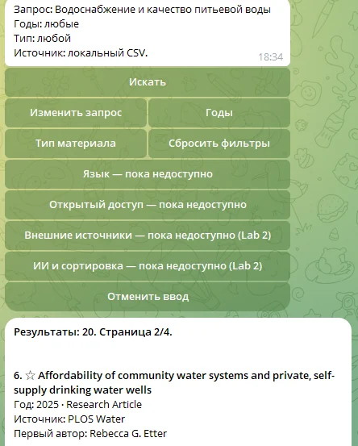
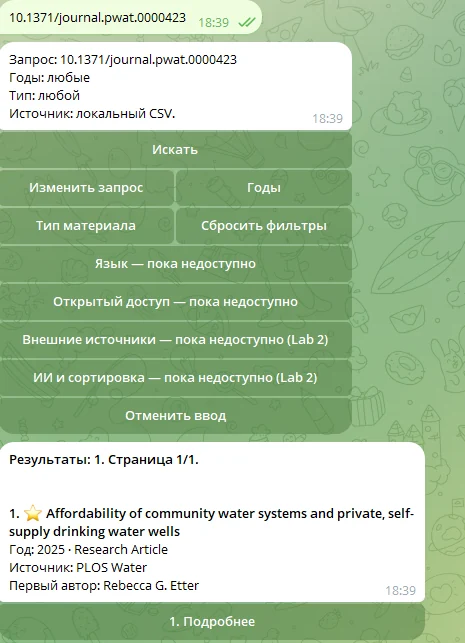
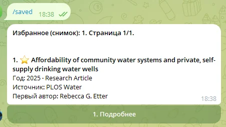

# Лабораторная работа №1. Создание Telegram-бота «Brilliant» detective

University: [ITMO University](https://itmo.ru/ru/)  
Faculty: [FICT](https://fict.itmo.ru/)  
Course: [Vibe Coding: AI-боты для бизнеса](https://github.com/itmo-ict-faculty/vibe-coding-for-business)  
Year: 2026/2027  
Group: U4225  
Author: Elchiyan Roman Romanovich  
Lab: Lab1  
Date of create: 12.10.2026  
Date of finished: 16.10.2026

Дата актуализации отчёта: 20.10.2026

## 1. Цель и задачи

**«Brilliant» detective** — [Telegram-бот для поиска научных публикаций](https://t.me/itmoftmi_err2026_bot). Цель работы — разработать приложение на Python с применением ИИ-инструментов программирования и реализовать поиск по локальному каталогу, хранение пользовательских данных и интерактивную навигацию.

Основные сценарии: тематический запрос, точный поиск по DOI, фильтрация публикаций, просмотр карточки и сохранение материала в избранное. Поисковый модуль должен обрабатывать русскоязычные запросы к англоязычному каталогу.

## 2. Средства разработки и данные

### 2.1. Методика разработки

Разработка выполнена в Visual Studio Code с расширением OpenAI Codex. ChatGPT использовался для подготовки требований, архитектуры и промптов; Codex — для реализации, исправления кода и запуска тестов.

| Этап | Результат |
| --- | --- |
| Базовая реализация | Команды Telegram, CSV-каталог, поиск по теме и DOI, фильтры, карточки, SQLite, избранное и проверка административных прав |
| Доработка поискового модуля | Гибридный поиск FTS5/BM25, RapidFuzz и E5; многоязычные запросы, кеш векторов, миграция SQLite и постраничная выдача |

[Промпты и этапы разработки](prompts.md). [Исходное техническое задание](../codex_lab1_brilliant_detective_prompt.md).

### 2.2. Каталог и технологический стек

Использован открытый набор [PLOS Water](../data/SOURCE.md) проекта [openwashdata/washopenresearch](https://github.com/openwashdata/washopenresearch): **434 публикации за 2022–2026 годы**, лицензия CC BY 4.0. Записи содержат названия, DOI, даты публикации, сведения об авторах, тип материала, журнал и ключевые слова.

| Компонент | Технология и назначение |
| --- | --- |
| Telegram-интерфейс | Python 3.13, `python-telegram-bot` 22.8, long polling |
| Хранение | SQLite: публикации, пользователи, настройки, история и избранное |
| Лексический поиск | SQLite FTS5/BM25 и RapidFuzz |
| Семантический поиск | `intfloat/multilingual-e5-small`, векторы размерности 384 |
| Вычисления | PyTorch 2.6.0, CUDA 12.4, NVIDIA GTX 960; резервное выполнение на CPU |
| Настройки и журналы | `.env`, `python-dotenv`, `logging` с ротацией |

## 3. Архитектура и реализация

### 3.1. Структура приложения

| Модуль | Ответственность |
| --- | --- |
| `bot.py`, `handlers.py` | Запуск, команды Telegram, формы и навигация |
| `search.py`, `semantic_search.py` | Получение кандидатов и объединение ранжирований |
| `sources.py` | Чтение и проверка CSV-каталога |
| `db.py` | SQLite, миграции, история выдач и избранное |
| `admin.py`, `config.py` | Административные права и конфигурация поиска |
| `benchmark_search.py`, `tests/lab1/` | Измерения производительности и автоматические проверки |

### 3.2. Поисковый алгоритм

Для DOI выполняется точное сопоставление нормализованного идентификатора. Тематический запрос обрабатывается тремя способами: FTS5/BM25 находит лексические совпадения, RapidFuzz учитывает опечатки, E5 сопоставляет смысл запроса и метаданных. E5 обрабатывает русский запрос и английские названия без предварительного перевода.

Ранжирования объединяются методом взвешенного **Reciprocal Rank Fusion (RRF)**. Фильтры года и типа материала применяются ко всем кандидатам. Векторы каталога рассчитываются при индексации и сохраняются в `runtime/semantic/`; при поиске вычисляется вектор запроса. Для E5 заданы таймаут и переход с CUDA на CPU. При недоступности модели используются FTS5 и RapidFuzz.

### 3.3. Хранение и пользовательский интерфейс

Схема SQLite версии 2 централизует метаданные публикаций; история и избранное ссылаются на идентификаторы материалов. Миграция из версии 1 переносит существующие записи. История ограничена 50 выдачами на пользователя и сроком 30 дней; избранное хранится отдельно.

Команды `/start`, `/help`, `/search`, `/saved`, `/cancel`, `/status` и `/admin` покрывают основные сценарии. На странице отображается пять результатов. Кнопки перелистывания, подробной карточки и избранного обновляют сообщение Telegram. Сервер проверяет доступ пользователя к выдаче и права на административные действия. Переключение семантического поиска через `/admin` сохраняется в SQLite.

## 4. Тестирование и результаты

### 4.1. Функциональная проверка

Автоматические тесты охватывают DOI, фильтры, опечатки, многоязычную релевантность, кеш индекса, таймауты, разграничение прав, миграцию SQLite и навигацию. Ручные сценарии выполнялись в Telegram.

| Проверка от 16.10.2026 | Результат |
| --- | --- |
| `unittest`, включая E5 и миграцию SQLite | 70 тестов прошли |
| `bot.py --check`, `pip check` | Успешно |
| Запрос «Водоснабжение и качество питьевой воды» | 20 результатов |
| DOI `10.1371/journal.pwat.0000423` | Одна соответствующая публикация |
| Избранное | Сохранённый материал доступен через `/saved` |
| Постраничная выдача | Переход на страницу 2 из 4 в одном сообщении |
| Вычисления E5 | Выполнение на GTX 960 через CUDA |

20.10.2026 повторно проверены шесть тестов E5: английские, русские и французские запросы, отсев нерелевантных запросов, устройство вычислений и память. Совместный прогон с одним тестом Cross-Encoder из Lab 2 завершился успешно: **7 тестов за 19,418 с**, загрузка моделей из сети отключена.

### 4.2. Производительность

| Измерение от 16.10.2026 | Время |
| --- | --- |
| Индексация 434 публикаций | 2,047 с |
| Загрузка готового индекса | 0,044 с |
| Повторный гибридный поиск | 0,10–0,12 с |

[Параметры и методика измерений](../docs/hybrid_search.md). [Протокол начальных проверок](evidence/local_checks.md).

## 5. Демонстрация работы

**Рисунок 1 — Поиск на русском языке.** По запросу «Водоснабжение и качество питьевой воды» получено 20 результатов; показана страница 2 из 4.

**Рисунок 2 — Точный поиск по DOI.** Запрос `10.1371/journal.pwat.0000423` возвращает одну публикацию.

**Рисунок 3 — Избранное.** Ранее сохранённая публикация доступна через команду `/saved`.

## 6. Выводы

Разработан Telegram-бот с гибридным многоязычным поиском по 434 научным публикациям. Реализованы точный поиск DOI, фильтры, постраничная выдача, избранное и разграничение прав. При использовании готового индекса повторный поиск занимал 0,10–0,12 с в измеренной конфигурации. Функциональные проверки подтвердили поиск на русском языке по англоязычным метаданным и сохранение пользовательских данных.

Режим Lab 1 запускается через `bot.py --stage lab1`. Расширение приложения описано в отчётах [Lab 2](../lab2/lab2_report.md) и [Lab 3](../lab3/lab3_report.md).
