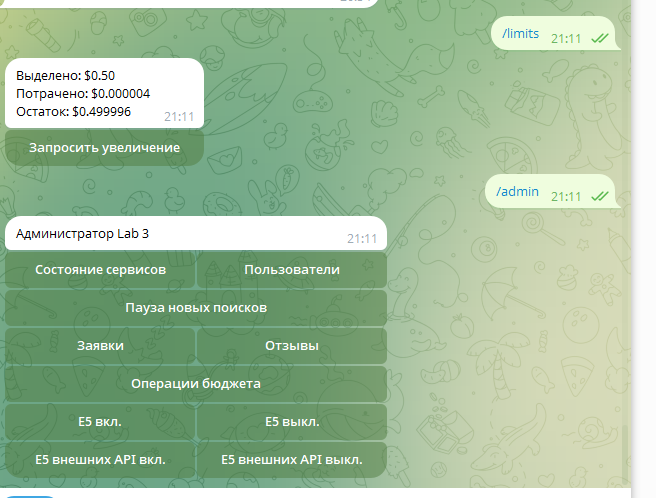
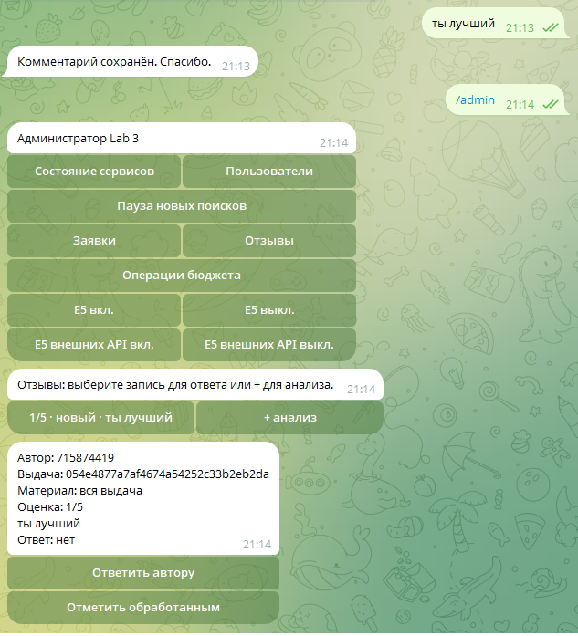
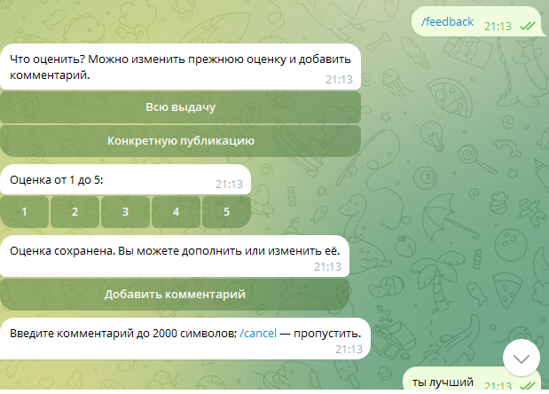
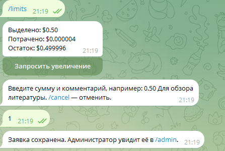
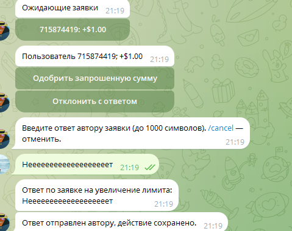
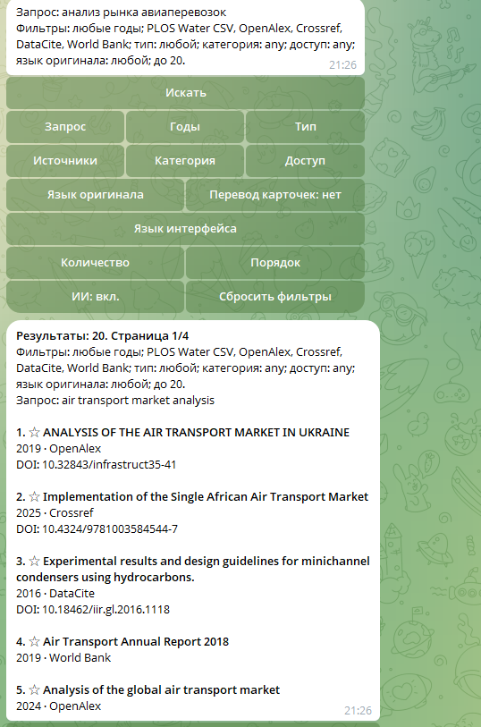
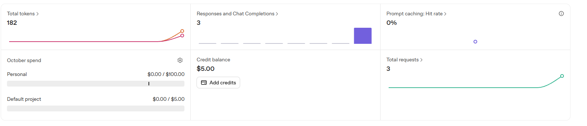

# Лабораторная работа №3. Развёртывание, администрирование и обратная связь

University: [ITMO University](https://itmo.ru/ru/)  
Faculty: [FICT](https://fict.itmo.ru/)  
Course: [Vibe Coding: AI-боты для бизнеса](https://github.com/itmo-ict-faculty/vibe-coding-for-business)  
Year: 2026/2027  
Group: U4225  
Author: Elchiyan Roman Romanovich  
Lab: Lab3  
Date of create: 12.10.2026  
Date of finished: 20.10.2026

Дата актуализации отчёта: 20.10.2026

## 1. Цель и состав приложения

Для [Telegram-бота «Brilliant» detective](https://t.me/itmoftmi_err2026_bot) реализованы запуск в polling и webhook, локальная инфраструктура платного ИИ, администрирование, управление бюджетами и сбор обратной связи. Поиск и работа с данными описаны в [отчёте Lab 2](../lab2/lab2_report.md).

Бот запускается на Windows из Python `.venv`. SQLite, Argos Translate, E5 и Cross-Encoder работают локально. Docker Compose содержит LiteLLM Proxy и PostgreSQL. LiteLLM доступен по `127.0.0.1:4000`, PostgreSQL не публикует внешний порт и сохраняет данные в постоянном томе `litellm_data`.

`scripts/prepare_services.py` готовит приватные параметры сервисов в `runtime/`. Контейнеры получают отдельные наборы переменных: PostgreSQL — параметры базы, LiteLLM — ключ провайдера и параметры Proxy. Telegram-токен остаётся у процесса бота. `.env`, базы, логи, модели и кеши исключены из Git.

## 2. Запуск и транспорт Telegram

`scripts/run.ps1` подготавливает сервисы и запускает `bot.py --stage lab3 --external`. Параметр `-AI` включает ИИ в конфигурации и запускает Docker Compose с ожиданием готовности сервисов. Пользователь отдельно включает платные функции в Telegram.

| Режим | Работа |
| --- | --- |
| Polling | Бот получает обновления Telegram исходящими запросами; публичный адрес не требуется |
| Webhook | ngrok публикует локальный порт 8080 по HTTPS; Telegram отправляет обновления на зарегистрированный адрес |

Webhook использует случайный путь и заголовок `X-Telegram-Bot-Api-Secret-Token`. Перед регистрацией проверяются туннель и целевой порт. При недоступности ngrok предусмотрен переход в polling. Перед polling удаляется прежний webhook с `drop_pending_updates=False`. Повторные update ID отсеиваются в SQLite; файловая блокировка ограничивает запуск одним экземпляром.

В ранних проверках ngrok выдавал ошибки авторизации и CRL/TLS. В последующей отдельной проверке HTTPS-туннель был установлен, реальные команды `/start` и `/status` обработаны через webhook. Длительная стабильность этого соединения не измерялась.

20.10.2026 после обновления кода запуск `run.ps1 -Mode webhook -AI` остановился на подключении к `dockerDesktopLinuxEngine`: движок Docker Desktop был недоступен. Этап запуска ngrok в этой попытке не выполнялся. Для повторного запуска требуется запущенный Docker Desktop и доступный раздел `Server` в выводе `docker version`.

## 3. Администрирование и бюджеты

Доступ к `/admin`, callback и текстовым административным действиям проверяется по `ADMIN_TELEGRAM_IDS`. Панель содержит состояние сервисов, пользователей, блокировку доступа, разрешение ИИ, паузу новых поисков, управление E5, заявки на бюджет и отзывы. Избранное и `/limits` доступны при паузе поиска.

Каждому пользователю соответствует virtual key LiteLLM с начальным бюджетом $0.50. PostgreSQL хранит ключи и расход; SQLite — настройки и журнал операций. `/limits` получает фактические `max_budget` и `spend`; при недоступности Proxy остаток обозначается как неизвестный.

Увеличение бюджета включает выбор пользователя и суммы, показ старого и нового лимитов, затем подтверждение. Операция имеет постоянный UUID. При неизвестном результате HTTP проверяется фактический лимит; повторное подтверждение не увеличивает его второй раз. Пользователь может отправить заявку с суммой и комментарием, администратор — одобрить или отклонить её с ответом автору.

В живой проверке подтверждены создание ключа, исходный бюджет $0.50, увеличение тестового лимита до $1.00, защита от двойного увеличения и сохранение ключа после перезапуска контейнеров. Успешный запрос `research-basic` записал стоимость $0.0000038 в LiteLLM/PostgreSQL. Проверки последних изменений не выполняли платных генераций.

## 4. Обратная связь и её анализ

`/feedback` открывает единую форму с категориями «Работа бота», «Результаты поиска» и «Конкретная публикация». Можно выбрать одну, две или три категории, добавить один общий комментарий и необязательную оценку 1–5. Для публикаций выбираются соответствующие материалы; общий отзыв о боте доступен без предварительного поиска.

До нажатия «Отправить отзыв» хранится только черновик. Отправка создаёт одну запись независимо от числа категорий. Повторное нажатие не дублирует запись. При редактировании сохраняются ID отзыва, ответ администратора и история изменений. Схема `lab_schema=4` переносит прежние отзывы и оценки; отзывы доступны после очистки истории поисков.

Администратор просматривает отзывы, категории, комментарии, оценки и связанные публикации, отмечает обработанные записи и отвечает автору выбранного отзыва. Платный ИИ-анализ запускается после отдельного подтверждения и использует служебный бюджет. Контекст включает выбранные отзывы и сохранённые данные результатов; идентификаторы пользователей не передаются, типовые контакты маскируются. Произвольный свободный текст не гарантирует полного удаления всех персональных сведений.

Стоимость, usage и ID ответа записываются в журнал ИИ-вызовов. Анализ выдаёт рекомендации и не меняет код, права или бюджеты. Сохранение результата и учёт стоимости проверены подменённым HTTP-транспортом; живой платный анализ отзывов отдельно не выполнялся.

## 5. Доработки интерфейса и поиска

По замечаниям владельца и переданной им обратной связи выполнены следующие изменения. Количество участников пользовательской проверки и повторная оценка интерфейса не зафиксированы.

| Замечание | Реализованное изменение |
| --- | --- |
| Длинные карточки | Компактный список; аннотация и расширенные метаданные доступны в подробностях |
| Неочевидные фильтры | Активные фильтры в форме и выдаче; кнопка сброса меняет следующий поисковый запрос |
| Непонятный отказ источника | Именованное предупреждение, сохранение доступных результатов и бесплатный повтор |
| Повторы одной работы Zenodo с разными DOI | Объединение явно связанных версий после фильтров, выбор последней подходящей версии |
| Недостаточный текст для ИИ-оценки | Передача полных полученных аннотаций при оценке и объяснении публикаций |

Регрессионные проверки подтверждают сохранение версии в избранном и после повторного открытия базы. После обновления нужен новый поиск: ранее сохранённые выдачи автоматически не пересчитываются.

## 6. Проверки и эксплуатация

| Проверка | Результат |
| --- | --- |
| Регрессионный набор 20.10.2026: поиск, источники, бюджеты, отзывы и интерфейс | 109 тестов прошли |
| Реальные E5 и Cross-Encoder на Windows | 7 тестов прошли за 19,418 с |
| Zenodo и полные аннотации на Windows после получения обновления | 14 тестов прошли за 2,271 с |
| Три связанные записи реального DataCite | Одна работа с сохранением всех DOI |
| Локальный HTTP-сервер PTB в предыдущих проверках | Неверный секрет — 403; неверный путь — 404; корректный запрос — 200 |
| Последняя попытка запуска с ИИ на Windows | Остановлена до запуска бота из-за недоступного Docker Engine |

Тестовые наборы частично пересекаются. Первые четыре строки относятся к функциональной проверке кода и моделей; они не подтверждают запуск Telegram и контейнеров после обновления. [Подробный протокол](evidence/final_checks.md) сохраняет даты предыдущих проверок.

Журнал `runtime/logs/bot.log` использует UTC и ротацию 5 MiB с тремя архивами. Для маскированной диагностики контейнеров предназначен `scripts/service_status.py`. Измерение 16.10.2026 охватило 171,8 с работы процесса и WorkingSet 986,4 MiB; длительный uptime и нагрузочная устойчивость этим измерением не устанавливались.

Команды запуска в PowerShell из корня проекта:

```powershell
docker version
.\scripts\run.ps1 -Mode polling -AI
```

Для webhook используется `-Mode webhook -AI`. Docker Desktop должен быть запущен; работа приложения и личные разрешения ИИ проверяются через `/status`, `/ai`, `/limits` и `/admin`.

## 7. Скриншоты работы бота

Скриншоты предоставлены владельцем проекта и сохранены в [`lab3/images/`](images/). Они показывают интерфейс и отдельные результаты проверки; сами по себе не подтверждают длительную бесперебойную работу или успешность всех сценариев.

**Рисунок 1 — Лимиты и административная панель.** Отображение выделенного бюджета и административных возможностей.



**Рисунок 2 — Работа администратора с отзывами.** Просмотр пользовательской обратной связи и действий по ней.



**Рисунок 3 — Отправка отзыва.** Пользовательский интерфейс обратной связи.



**Рисунок 4 — Заявка пользователя на увеличение бюджета.** Пользовательский сценарий обращения к администратору.



**Рисунок 5 — Рассмотрение заявки администратором.** Интерфейс обработки и ответа на запрос об увеличении бюджета.



**Рисунок 6 — Поиск по внешним источникам.** Выдача материалов с указанием происхождения и DOI.



**Рисунок 7 — Использование OpenAI API.** Интерфейс учёта запросов провайдера; персональный бюджет и списания отдельно подтверждались через LiteLLM/PostgreSQL.



## 8. Результат работы

Реализованы два транспорта Telegram, локальное развёртывание LiteLLM/PostgreSQL, персональные бюджеты, административные операции и единая форма обратной связи. Обновления от 20.10.2026 устраняют повторы версий Zenodo и передают ИИ полные аннотации. Код и модели прошли указанные проверки; последний запуск на Windows требует восстановления доступности Docker Desktop.

Веб-поиск и пользовательский вызов резервной Sol в текущей версии не подключены. Повторный пользовательский опрос, длительное наблюдение и отдельный живой ИИ-анализ отзывов не проводились.

[Команды запуска и диагностики](../docs/lab23_operations.md). [Подготовка к GitHub](../docs/github_delivery.md). [Протокол проверок](evidence/final_checks.md).
